# Bienvenida

OmniAccess es una plataforma de seguridad que reúne en un solo panel el control de accesos de vehículos y personas, el conteo de filas y la vigilancia del perímetro. Sobre las analíticas que ya traen las cámaras suma una inteligencia artificial propia, **OmniVision**, que corre en un servidor dentro de la instalación y revisa cada evento antes de avisar.

Este manual recorre el sistema sección por sección, en el mismo orden en que aparecen en el menú. Cada capítulo dice para qué sirve la pantalla, cómo se llega y qué se puede hacer en ella.

## Los tres productos

OmniAccess es una familia de tres productos, cada uno para controlar una cosa distinta. Comparten el mismo panel, así que una instalación puede tener uno, dos o los tres.

| Producto | Para qué | Pantallas propias |
|---|---|---|
| **OmniAccess LPR** | Vehículos: lectura de matrículas, padrón, visitas e invitados | Monitor LPR, Historial, Lecturas de cámara, Vehículos, Visitas, Invitados, Plazas |
| **OmniAccess Face** | Personas: terminales de reconocimiento facial, tarjetas y porteros | Monitor facial, listas de rostros, Tags RFID |
| **OmniAccess Filas** | Aforo de filas y salas de espera | Control de filas, Flujo, Reportes, Pantalla de sala, Horarios |

> **Intrusión viene incluida en los tres productos**: Monitor de intrusión, líneas y zonas por cámara, verificación con OmniVision, Gestión de alarmas y centrales de alarma. También son comunes a los tres el mapa, los monitores de pared, las notificaciones, los roles, la auditoría y la salud del sistema.

## Cómo está organizado el panel

El menú de la izquierda se arma según el producto y el rol de cada usuario: nadie ve una pantalla que no puede usar. Está dividido en tres bloques.

- **Operación**: los monitores en vivo (LPR, Intrusión, CCTV), la Gestión de alarmas y el Historial.
- **Gestión**: personas, monitores de pared, mapa, lista negra, unidades, dispositivos, calendario e invitados.
- **Por producto**: en OmniAccess LPR, Vehículos, Lecturas de cámara, Tags RFID y Grupos de acceso.

Abajo del menú están siempre a la vista los usuarios en línea, el uso de la placa de video (GPU) del servidor, el cambio de tema claro u oscuro y la salida.

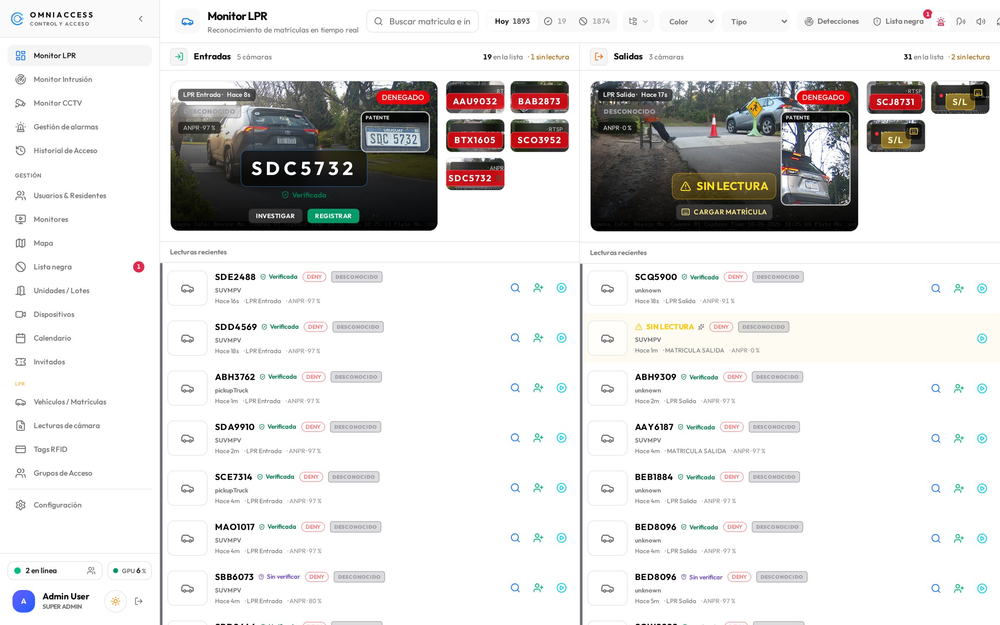

## Ingresar al sistema

» Dirección de la instalación → Iniciar sesión

Se ingresa con **nombre de usuario** y contraseña. El campo pide el nombre, no el correo. Después del ingreso, cada usuario entra directamente en la primera pantalla que su rol puede abrir.

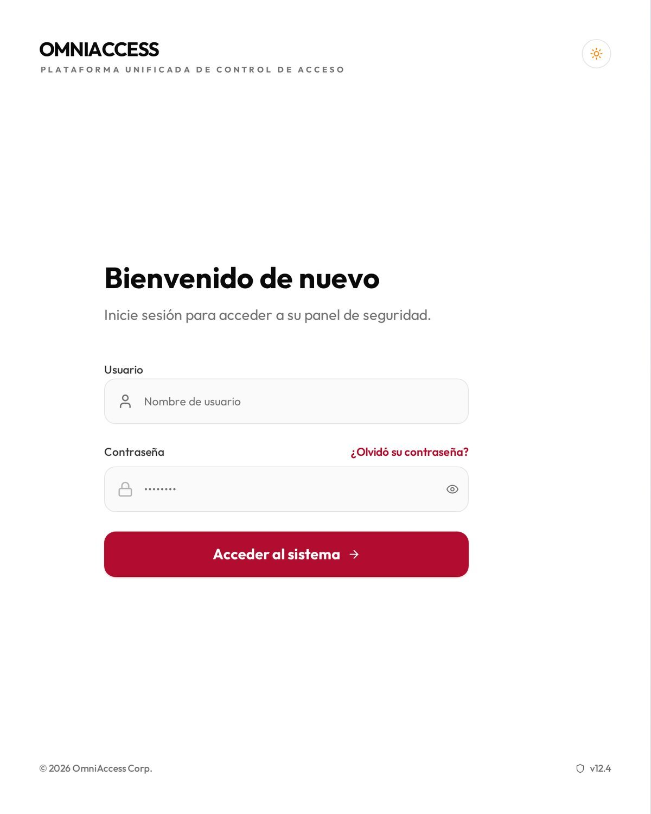

> Cada entrada al panel, correcta o fallida, queda registrada en la Auditoría con usuario, fecha y hora.

# Monitor LPR

» Menú → Monitor LPR

Es la pantalla de trabajo de la garita y del puesto de monitoreo para vehículos. Muestra en vivo cada matrícula que leen las cámaras de entrada y de salida.

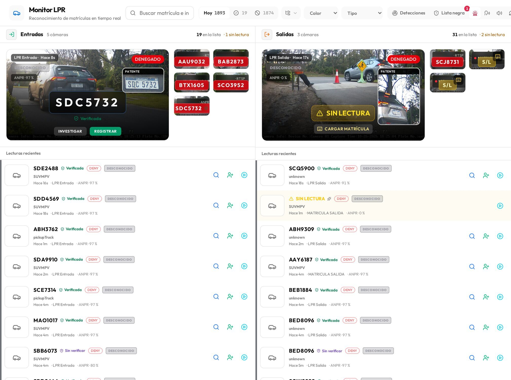

## Qué se ve

- **Dos columnas, Entradas y Salidas**, con la cantidad de cámaras de cada lado y cuántos vehículos de la lista pasaron hoy.
- **La última lectura en grande**: la foto de la cámara, el recorte de la chapa, la matrícula, el resultado (permitido, denegado, registrado o no registrado) y el porcentaje de confianza de la lectura.
- **La tira de lecturas recientes** de cada lado, con miniatura, matrícula, tipo de vehículo, cámara y hace cuánto pasó.
- **Contadores del día**: total de lecturas, permitidas y denegadas.

## La doble verificación

Cada lectura de la cámara se vuelve a leer con el motor propio de OmniAccess. La marca junto a la matrícula dice cómo terminó:

| Marca | Qué significa |
|---|---|
| **Verificada** | La lectura de la cámara y la relectura coinciden |
| **Sin verificar** | Todavía no se releyó o no hubo cuadro para releer |
| **Sin lectura** | La cámara disparó pero no leyó la chapa; se puede cargar a mano con «Cargar matrícula» |

> Las lecturas dudosas no se descartan: se marcan, para que el operador las vea y decida.

## Barrio abierto o cerrado

En **Configuración → Modos → Visitas y patrones** se elige el modo de acceso.

- **Cerrado** (con barrera): el monitor dice *Permitido* o *Denegado* y suena el tono de denegado.
- **Abierto** (sin barrera): dice *Registrado* o *No registrado*, cuenta todas las entradas y salidas, y en lugar de alertas usa los avisos a la guardia.

## Acciones sobre una lectura

- **Investigar**: abre la ficha del evento con todo lo que se sabe de esa matrícula.
- **Registrar**: da de alta la matrícula en el padrón, como residente, proveedor o visita, o la manda a la lista negra.
- **Buscar** (barra superior): escribí una matrícula para ver su historial completo.
- **Filtros** por color y tipo de vehículo, y accesos rápidos a **Detecciones** y **Lista negra**.
- **Sonido**: se prende y se apaga desde la barra; el navegador pide un primer clic para habilitarlo.

# Ficha del evento

» Monitor LPR o Historial → tocar una captura

La ficha es la vista completa de un evento. La captura ocupa casi toda la pantalla y el resto de la información se ordena a la izquierda.

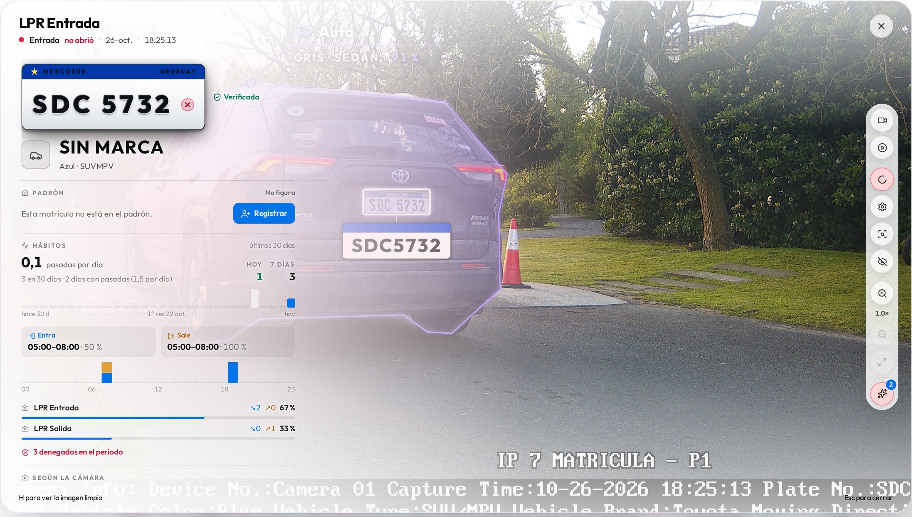

## Qué muestra

- **La matrícula** en formato de chapa Mercosur, con el país y la marca de verificación.
- **Marca, color y carrocería** del vehículo, según la cámara y según OmniVision.
- **Padrón**: si la matrícula figura y a quién pertenece, o el botón «Registrar» si no figura.
- **Hábitos de los últimos 30 días**: pasadas por día, cuántas hoy y en 7 días, la primera vez que se vio, la franja horaria en que suele entrar y salir, y por qué cámaras pasa.
- **Denegados del período**, si los hubo.
- **Las siluetas de OmniVision** sobre la foto, con la clase, el color y la confianza de cada objeto.

## Herramientas del visor

La barra vertical de la derecha tiene, de arriba hacia abajo: ver el video del momento, reproducir la grabación del grabador, buscar la misma matrícula en otras cámaras, ajustes del visor, recortar, mostrar u ocultar las siluetas, acercar y alejar, y la cantidad de detecciones de OmniVision en ese cuadro.

> Atajos de teclado: **H** muestra la imagen limpia, sin siluetas. **Esc** cierra la ficha.

Desde la ficha también se puede **compartir el clip** del evento por Telegram con un toque.

# Historial de accesos

» Menú → Historial de Acceso

Todas las lecturas y eventos guardados, con filtros para encontrar un vehículo, una persona o un momento.

## Tres vistas

El selector de la derecha cambia la forma de ver los resultados. La elección queda recordada en ese navegador.

- **Lista**: una fila por evento, con hora, cuadro, tipo (entrada o salida), matrícula, cámara, resultado, lo que vio OmniVision y señales.
- **Mosaico**: las capturas en grilla.
- **Bento**: un mosaico denso, con las denegadas y el merodeo en tamaño grande.

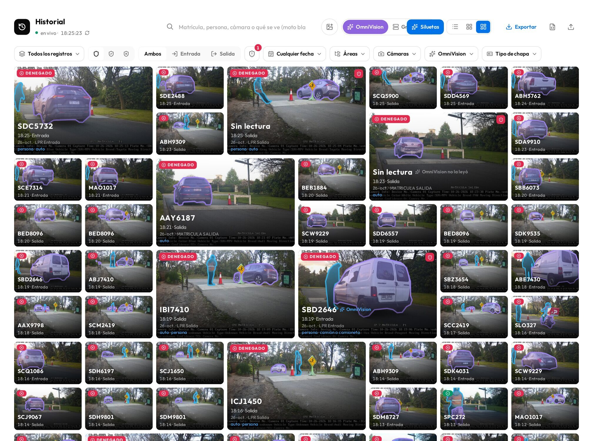

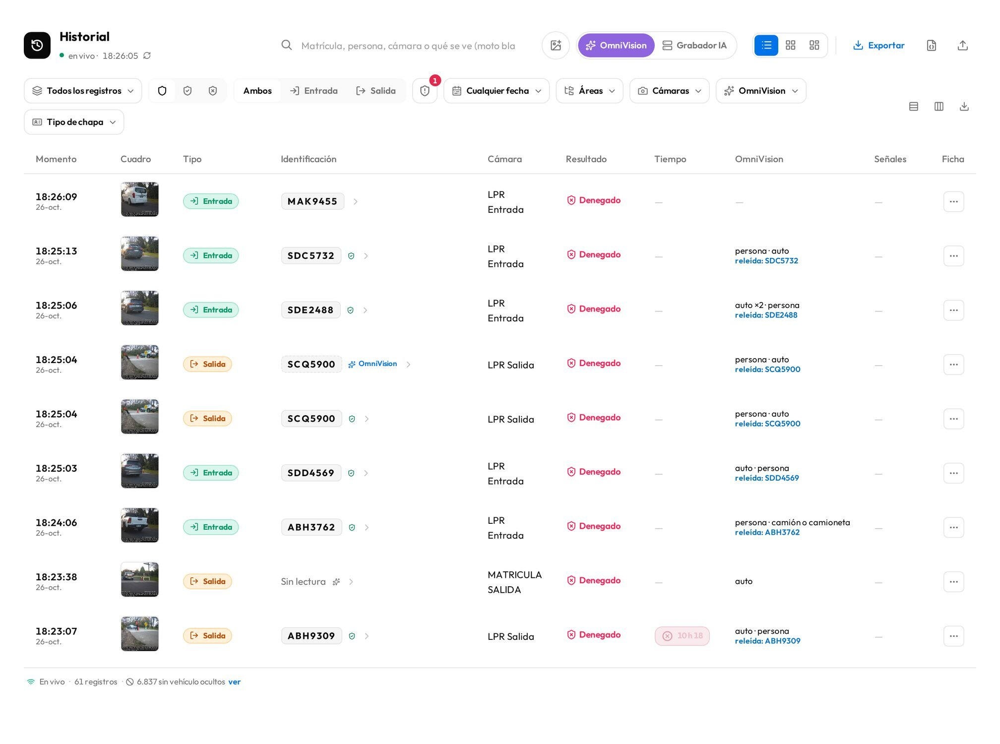

## Filtros

- **Buscador**: matrícula, persona, cámara o lo que se ve («moto blanca»).
- **Sentido**: ambos, entrada o salida.
- **Resultado**: todos, permitidos o denegados.
- **Fecha**: cualquier fecha o un rango.
- **Áreas y cámaras**.
- **OmniVision**: por lo que detectó la IA (personas, autos, motos, taxis, colores).
- **Tipo de chapa**: Mercosur, moto uruguaya o uruguaya anterior.

## OmniVision y Grabador IA

Los dos interruptores de la barra superior eligen dónde se busca:

- **OmniVision**: busca en lo que registró la IA propia.
- **Grabador IA**: busca en el grabador de video, con su propia búsqueda inteligente.

El botón **Siluetas** dibuja sobre cada captura lo que detectó OmniVision. Es la misma opción que el interruptor del visor.

## Exportar

**Exportar** descarga los resultados filtrados como planilla. Desde el ícono de PDF se arma un informe.

# Lecturas de cámara

» Menú → Lecturas de cámara

Compara, lectura por lectura, lo que leyó cada cámara LPR con lo que leyó OmniAccess y lo que releyó OmniVision. Sirve para saber cuánto se puede confiar en cada cámara.

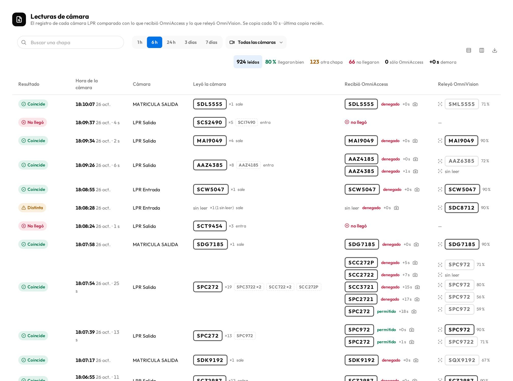

## Qué muestra

- **Resultado** de la comparación: *Coincide*, *Distinta* o *No leyó*.
- **Leyó la cámara**, **Recibió OmniAccess** y **Releyó OmniVision**, cada uno con su chapa.
- **Totales del período**: lecturas, porcentaje que coincide, cuántas corrigió OmniVision, cuántas no se leyeron y la demora.

Tocar una fila abre el cajón de comparación, con la lupa sobre la chapa, los recortes y las diferencias marcadas en rojo.

# Mapa

» Menú → Mapa

El mapa del barrio o del predio, en satélite, con las cámaras, los lotes y el movimiento en vivo.

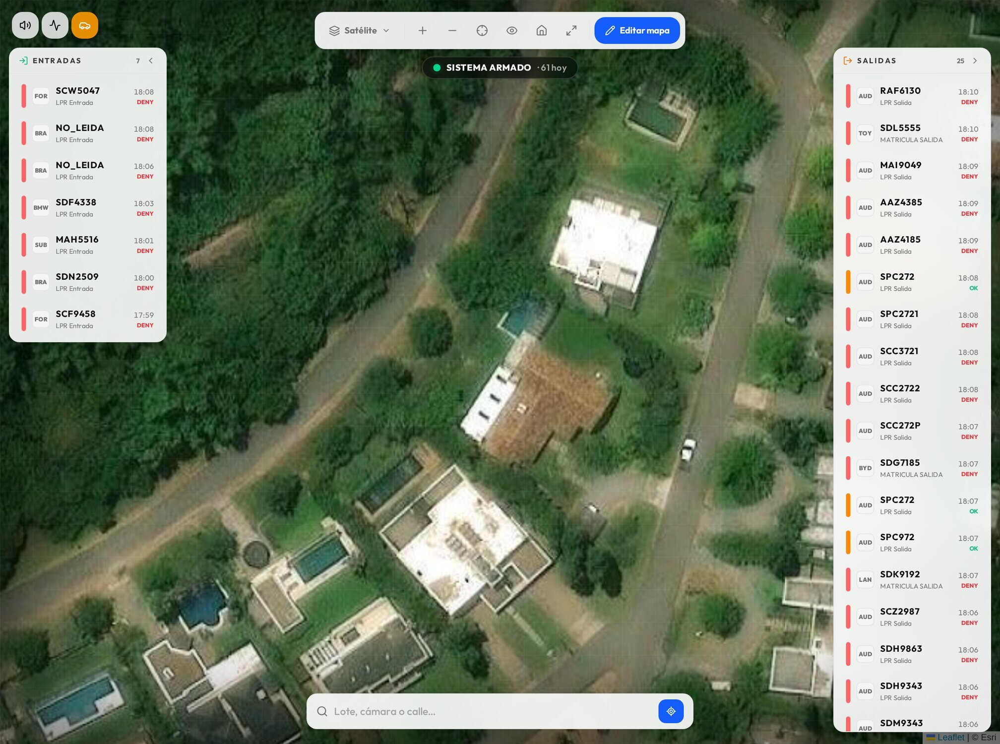

## Qué se ve

- **Entradas y salidas** en dos columnas laterales, con la matrícula, la cámara y la hora.
- **El estado del sistema**, por ejemplo «Sistema armado».
- **Las cámaras** en su lugar. Una alarma se marca sobre la cámara que la generó.
- **El recorrido** de un vehículo entre cámaras y los estacionados con su tiempo.

## Usarlo

- El **buscador** de abajo encuentra un lote, una cámara o una calle.
- La barra flotante de arriba cambia la vista (satélite o plano), acerca y aleja, y abre el **Editor de mapa**.
- Una cámara del mapa puede fijarse en una ventana de video, que queda abierta al cambiar de pantalla.

> El editor de mapa (ubicar cámaras, dibujar lotes, subir un plano) pide el permiso de edición del mapa.

# Monitor de intrusión

» Menú → Monitor Intrusión

La vigilancia del perímetro. Muestra las cámaras de intrusión con sus líneas y zonas dibujadas, y la actividad reciente a la derecha.

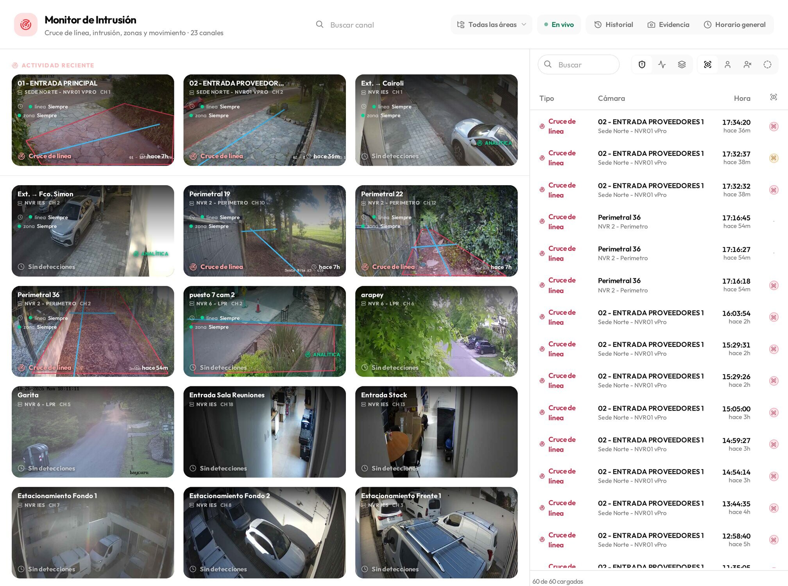

> El módulo de intrusión está incluido en los tres productos.

## Qué se ve

- **Una tarjeta por cámara** con su nombre, el grabador y canal, si la línea y la zona están armadas y en qué horario, y el último evento («Cruce de línea, hace 7 h» o «Sin detecciones»).
- **La lista de actividad** con el tipo de evento, la cámara y la hora.
- **Filtros** por área, por cámara y por tipo: cruce de línea, intrusión en zona y movimiento.

## Dibujar líneas y zonas

Desde el ícono de calibración de cada cámara se abre el **calibrador**:

1. Elegí qué editar con el selector **1 a 4**: hay hasta cuatro líneas y cuatro zonas por cámara.
2. Dibujá sobre el video. Las demás líneas y zonas se ven tenues para no confundir.
3. Ajustá la **sensibilidad** y el **objetivo** (persona, vehículo o ambos).
4. Tocá **Guardar**. El sistema escribe la regla en la cámara y la vuelve a leer para confirmar que quedó como se pidió.

> Las cámaras tardan entre 30 y 50 segundos en aplicar cada cambio, y un guardado puede llevar uno o dos minutos. El calibrador avisa cuando termina y si algo no quedó como se pidió.

## Horario general de armado

**Horario general** aplica un mismo horario a las reglas de todas las cámaras de intrusión. Dentro del horario la cámara está **armada**: manda el cruce o la zona al instante, suena en el panel, en el bot y queda en el historial con foto. Fuera del horario está **desarmada**: sigue grabando en el grabador pero no avisa.

El horario vive en la cámara, no en OmniAccess: se escribe en cada equipo y se relee para confirmar. Después de aplicar el criterio general, cada cámara se puede ajustar por separado.

## Evidencia e historial

- **Evidencia** reúne todas las capturas de intrusión con filtros por tipo de evento, cámara, estado (pendientes o revisadas) y lo que vio OmniVision (con alguien, sin nadie, sin analizar).
- **Historial** lista los eventos para buscar uno puntual.

## Verificación con OmniVision

Cuando una cámara dispara, OmniVision mira la captura y además un cuadro propio tomado en ese momento. El veredicto aparece en la tarjeta del evento:

| Veredicto | Qué significa |
|---|---|
| **Confirmada** | Hay una persona o un vehículo sobre la línea o dentro de la zona |
| **Hay alguien** | Hay alguien en la escena, aunque no sobre la regla |
| **Sin nadie** | OmniVision no vio a nadie: probablemente una falsa alarma |

Cada regla de notificación de intrusión puede **avisar siempre** o **avisar sólo si OmniVision ve a alguien**. Si el veredicto no llega a tiempo, el aviso sale igual.

## La alerta en pantalla

Una intrusión real abre una alerta con foto, video y sonido en cualquier pantalla del panel. Desde la alerta se **toma** el evento, se **pasa** a otro operador, se marca como **falsa** o se **desactiva**. Mientras no se resuelve, una barra roja queda visible en todo el panel.

# Gestión de alarmas

» Menú → Gestión de alarmas

Todos los eventos que piden atención, en una sola cola: lecturas LPR, intrusiones y alarmas de centrales.

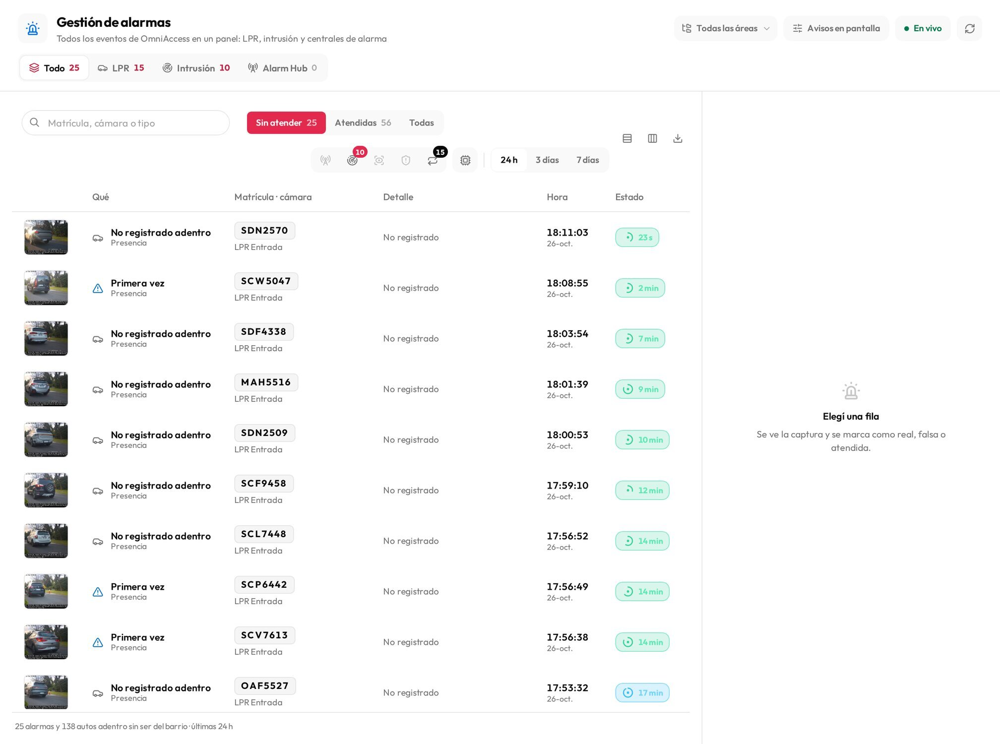

## Pestañas y filtros

- **Todo, LPR, Intrusión y Alarm Hub**, cada una con su contador.
- **Sin atender, Atendidas y Todas.**
- **Rango**: 24 h, 3 días o 7 días.
- **Área** y **equipo**, y un buscador por matrícula, cámara o tipo.

## Tratar una alarma

1. Elegí una fila: a la derecha se abre la captura con su detalle.
2. **Tomala**: queda a tu nombre y los demás ven quién la tiene.
3. Marcala como **real** o **falsa** y dejá una nota si hace falta.
4. Cada acción queda en la **bitácora** de esa alarma, con quién y cuándo.

> Una alarma tomada por otro operador sólo se puede quitar indicando el motivo, que queda registrado.

## Centrales de alarma (Alarm Hub)

OmniAccess recibe los eventos de centrales de alarma por **SIA DC-09** y **Contact ID**, también a través de receptores como el IPC10 de Paradox, y habla por ISAPI con las centrales Hikvision AX PRO.

- Cada evento llega con su **prioridad** por clase: robo, pánico, coacción, incendio y emergencia médica son prioridad 1; sabotaje, 2; técnicas, 3; fallos, 4.
- Las de prioridad 1 y 2 abren la ficha con sonido en cualquier pantalla.
- **Tratar** un evento pide elegir el cierre (real, falsa u otro) y escribir lo que se hizo. Es lo único que lo termina.
- Cada prioridad puede tener un **procedimiento** con pasos; cada paso queda con hora y operador.
- Si nadie toma una alarma en el tiempo configurado, se **escala** y avisa.
- **Tiempos** muestra cuánto tarda cada operador en tomar y tratar los eventos.
- La ficha muestra el video de las cámaras de la zona de la alarma.

La configuración está en **Configuración → Modos → Centrales de alarma**: prioridades, cierres, procedimiento, ventana y escalado.

# Monitor CCTV

» Menú → Monitor CCTV

Video en vivo de las cámaras y los canales de los grabadores, en mosaico.

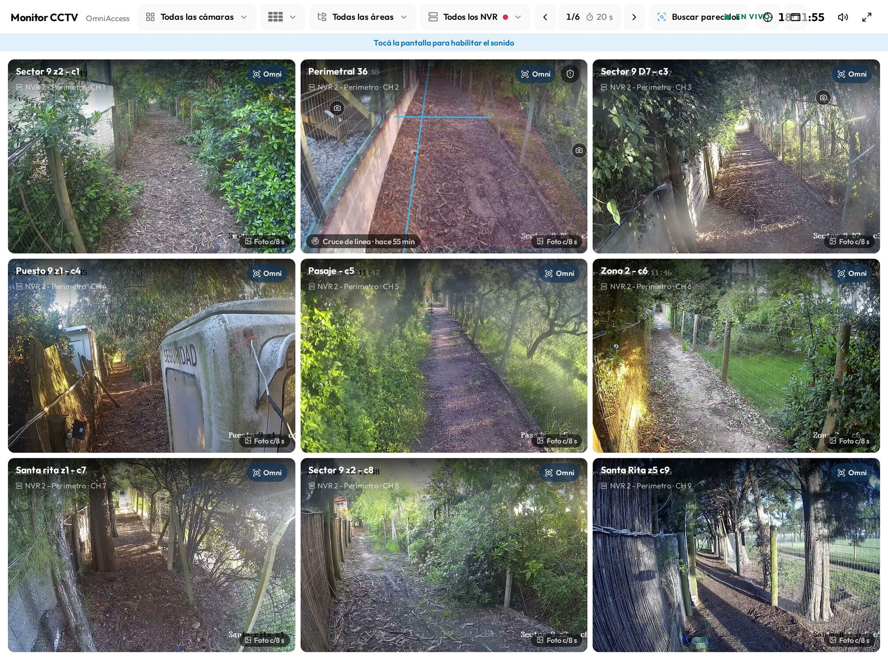

## Usarlo

- Elegí las cámaras o un grabador completo y la grilla (cantidad de cuadros).
- Filtrá por área.
- **Buscar parecidos**: congelá un cuadro, elegí si buscás una persona, un vehículo, un objeto o un animal, y OmniVision trae las veces que algo parecido pasó por las cámaras. También se puede subir una foto desde el celular con un código QR.
- La barra superior muestra el uso de CPU, GPU y memoria del servidor.

# OmniVision

» Configuración → OmniVision

OmniVision es la inteligencia artificial propia de OmniAccess. Corre en el servidor de la instalación, con modelos de licencia libre, y no manda imágenes a la nube. Sus pantallas están agrupadas en una barra de pestañas: Analíticas, Reglas, Detecciones, Buscar, Relecturas y Verificación.

## Qué sabe hacer

| Capacidad | Qué hace |
|---|---|
| Detección | 80 clases de objetos: personas, autos, motos, camiones, bicicletas, animales, bolsos y más |
| Siluetas | El contorno exacto de cada objeto, no sólo un rectángulo |
| Atributos | Color y carrocería del vehículo; ropa, chaleco, casco y mochila de la persona |
| Pose | La postura de la persona: de pie, agachada o acostada |
| Seguimiento | Sigue cada objeto cuadro a cuadro y guarda su recorrido |
| Lectura de texto | Rotulados de camionetas, carteles y chapas en cámaras comunes |

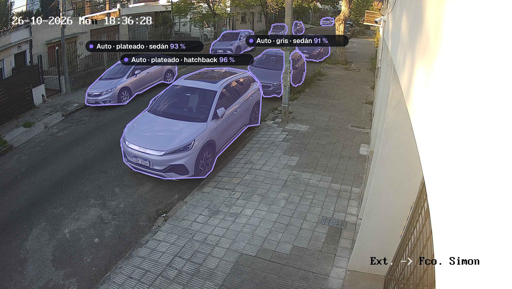

## Analíticas

» OmniVision → Analíticas

El tablero de lo que OmniVision está mirando: cuántas cámaras analiza, la carga del motor, el estado y la cantidad de análisis del día. Por cada cámara se ve qué analíticas tiene (registro, búsqueda, lecturas, relectura), cada cuánto mira y cuánto consume.

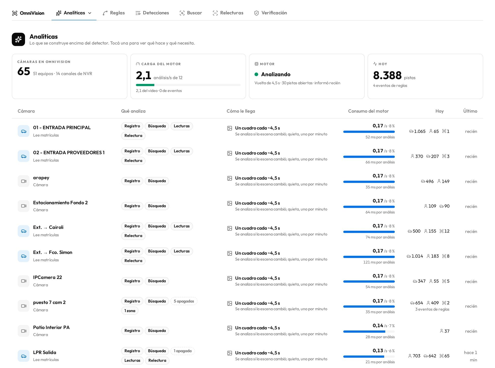

## Reglas

» OmniVision → Reglas

Una regla es una línea o una zona sobre el cuadro de una cámara, y lo que hay que hacer cuando algo la cruza o se queda. Se mira cada dos segundos y se sigue a cada objeto por su pie, donde toca el piso.

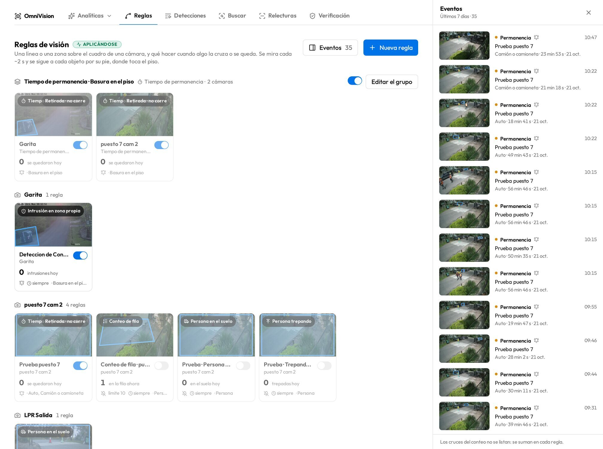

Reglas disponibles:

- **Intrusión en zona propia** y **cruce de línea propio**, en cualquier cámara.
- **Merodeo**: una persona que da vueltas dentro de la zona más de un tiempo (90 segundos por defecto). Quedarse quieto no cuenta.
- **Objeto retirado**: aprende lo que está quieto en la zona (bicicleta, moto, mochila, silla, maceta) y avisa si desaparece. Si una persona lo tapa, no cuenta como faltante. El aviso guarda la foto de antes y la de después.
- **Tiempo de permanencia**: un vehículo o una persona que se queda más de lo permitido.
- **Conteo de fila**: personas dentro de la zona, con límite, aviso y espera estimada.

Cada regla tiene su horario y se puede prender o apagar con su interruptor. El panel **Eventos** muestra lo que dispararon las reglas en los últimos días.

## Detecciones

» OmniVision → Detecciones

Todo lo que OmniVision vio pasar, con su mejor foto y lo que sabe de cada objeto. Se filtra por rango, por grupo (personas, vehículos, motos, animales, bultos) y por clase, con el conteo del período.

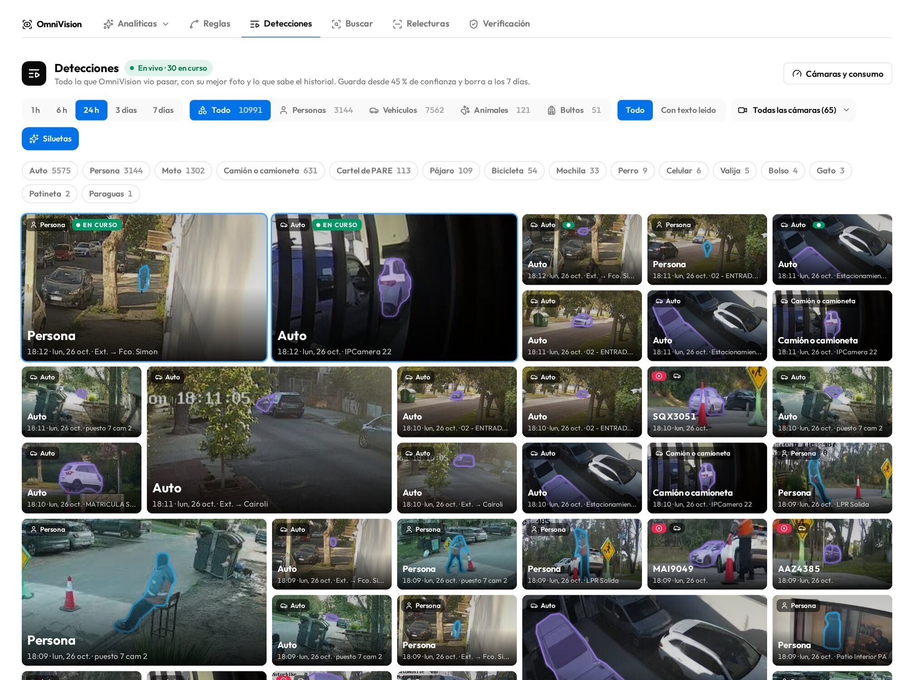

## Buscar

» OmniVision → Buscar

Búsqueda por palabras o con una foto, en todo lo que registraron las cámaras.

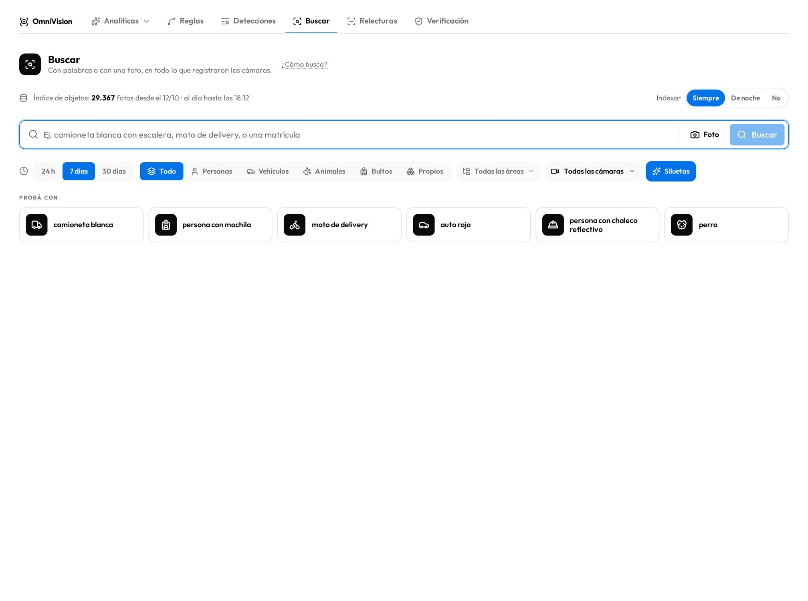

1. Escribí lo que buscás en lenguaje común: «camioneta blanca con escalera», «moto de delivery», «persona con chaleco reflectivo».
2. O tocá **Foto** para buscar a partir de una imagen.
3. Filtrá por período (24 h, 7 o 30 días), por grupo, por área y por cámara.
4. Desde cualquier resultado, **Buscar parecidos** trae los que se le parecen.

> La pantalla separa los resultados claros de los posibles. Si nada se parece lo suficiente, lo dice y muestra el resto atenuado.

## Verificación

» OmniVision → Verificación

Por cámara, cruza lo que dijo OmniVision con lo que decidió la guardia. Sirve para saber en qué cámaras conviene avisar sólo cuando OmniVision ve a alguien.

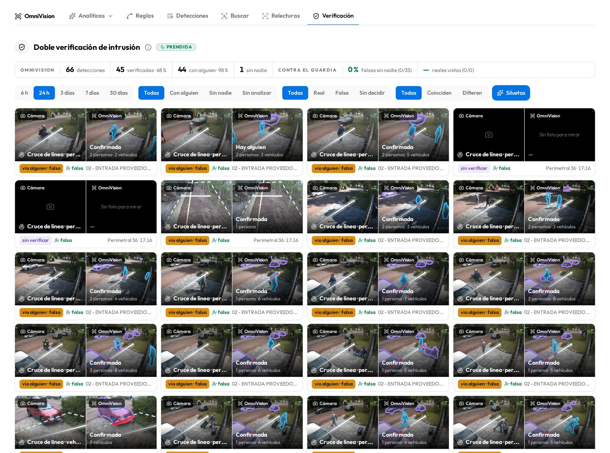

Muestra cuántas detecciones verificó, cuántas tenían a alguien, cuántas falsas no tenían a nadie (lo que se ahorraría) y cuántas reales vio. Cada tarjeta enfrenta la captura de la cámara y el cuadro de OmniVision.

## Mapa de calor

» OmniVision → Analíticas → Calor

Por dónde se mueve la gente o los vehículos en cada cámara, sumando los recorridos registrados. Las zonas más transitadas se ven más intensas sobre el cuadro.

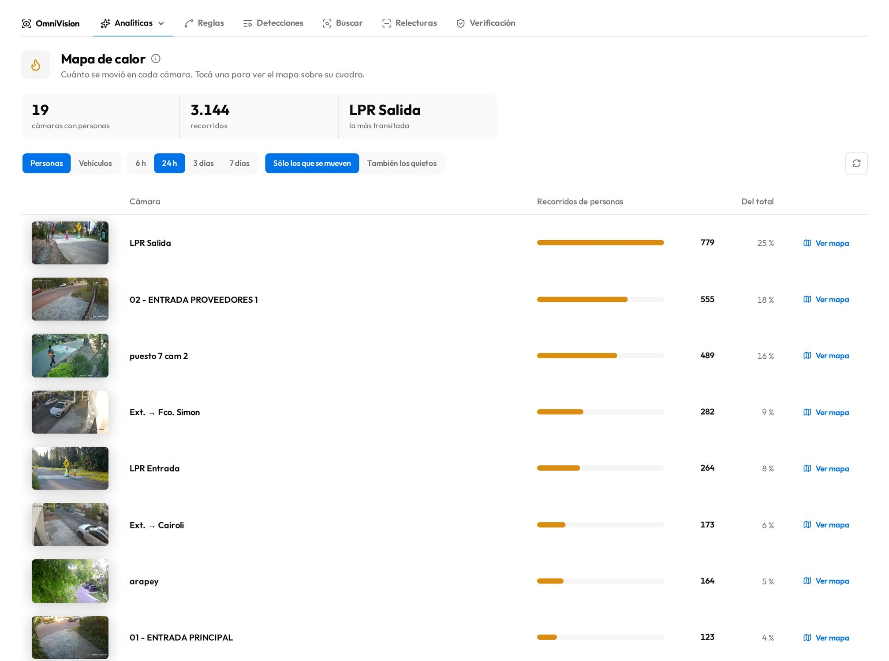

## Estacionamiento

» OmniVision → Analíticas → Estacionamiento

Una franja sobre el cordón con los lugares que entran. OmniVision mira cuáles tienen un vehículo: se ocupa a los 45 segundos, avisa «estacionó» a los 3 minutos y se libera a los 90 segundos sin verlo.

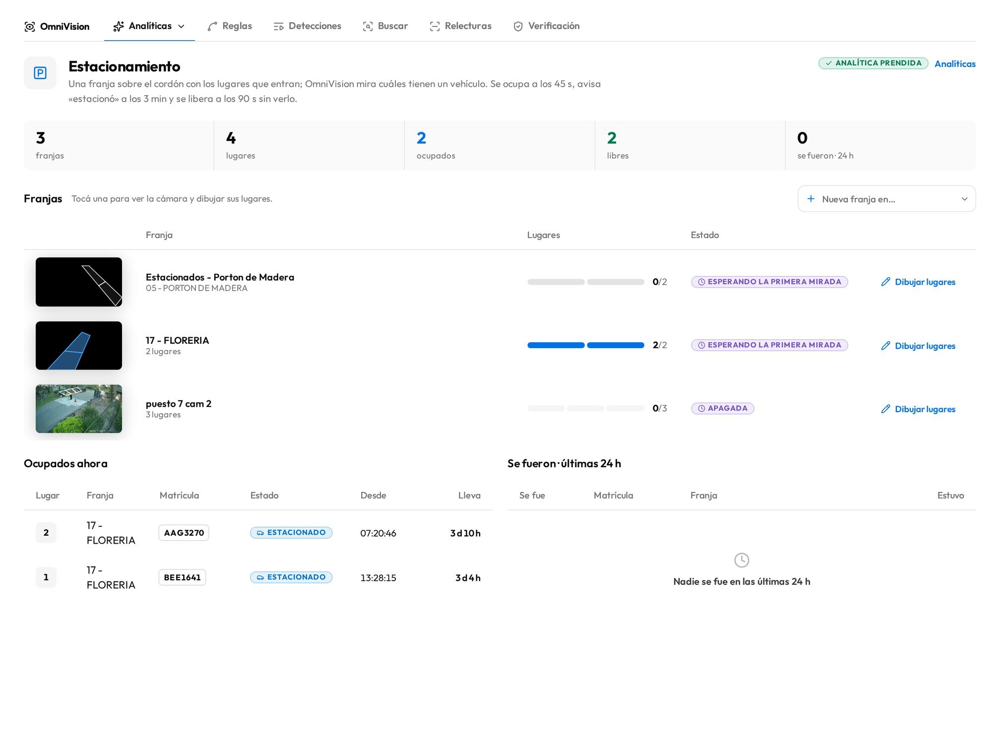

- **Franjas**: cada una con su cámara, sus lugares y su estado. «Dibujar lugares» abre la cámara para marcarlos.
- **Ocupados ahora**: lugar, franja, matrícula, desde cuándo y cuánto lleva.
- **Se fueron en las últimas 24 h**, con cuánto estuvo cada uno.

## Entrenar

» OmniVision → Entrenar

Analíticas a medida para cosas que están siempre en el mismo lugar: contenedor lleno, portón abierto, barrera arriba, lugar ocupado.

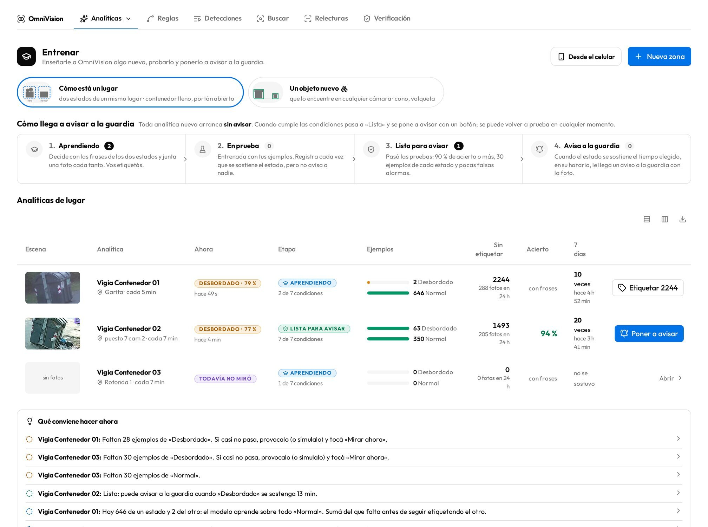

1. **Elegí la zona** de la cámara y nombrá los dos estados: el que avisa («Desbordado») y el normal («Normal»).
2. **Empieza a juntar muestras** solo, comparando con las frases de cada estado.
3. **Etiquetá** las muestras: una por vez, con dos botones o con el teclado (1 y 2, espacio salta, Z deshace).
4. **Entrená** con al menos 5 ejemplos de cada estado; la meta es 30. El acierto se mide con ejemplos que el modelo no vio.
5. **Activá el aviso** cuando el acierto sea bueno. El estado tiene que sostenerse un tiempo (15 minutos por defecto) para avisar.

> Por defecto una analítica nueva no avisa: sólo registra, para probarla antes de confiar en ella.

## Filas con OmniVision

» OmniVision → Analíticas → Filas

El conteo de personas en una fila con cualquier cámara, sin analítica de fábrica. Muestra por fila el aforo contra el límite, el estado, cuántos entraron y salieron y la espera.

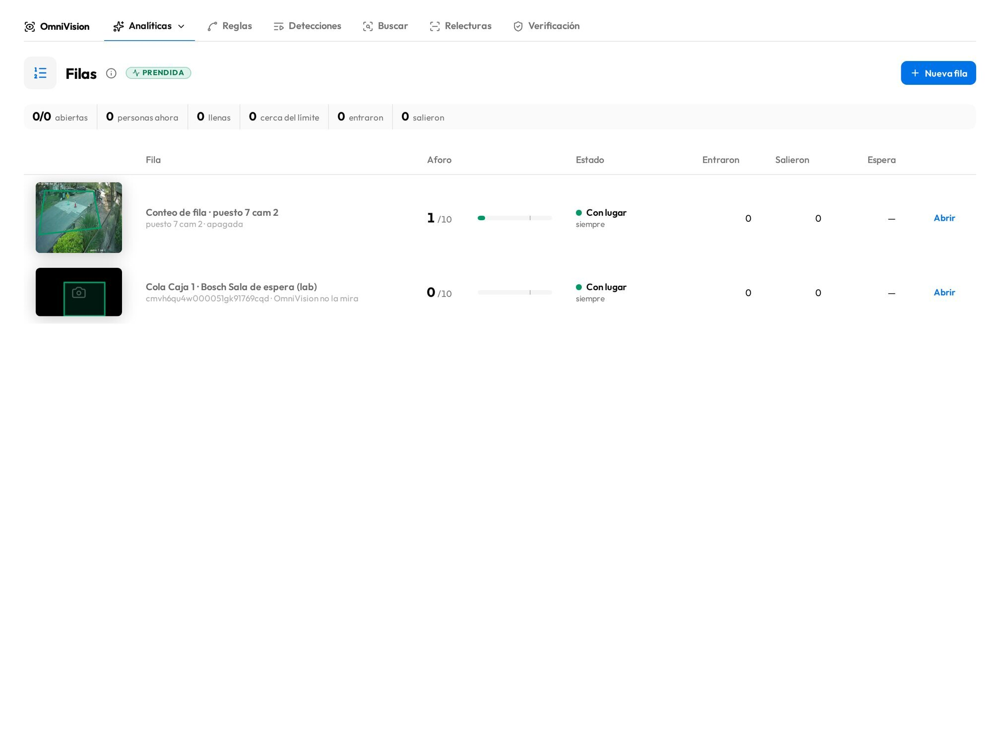

# Monitores de pared

» Menú → Monitores

Páginas hechas para los monitores de un centro de monitoreo: sin menú, oscuras, legibles a tres o cuatro metros, a pantalla completa y de sólo lectura.

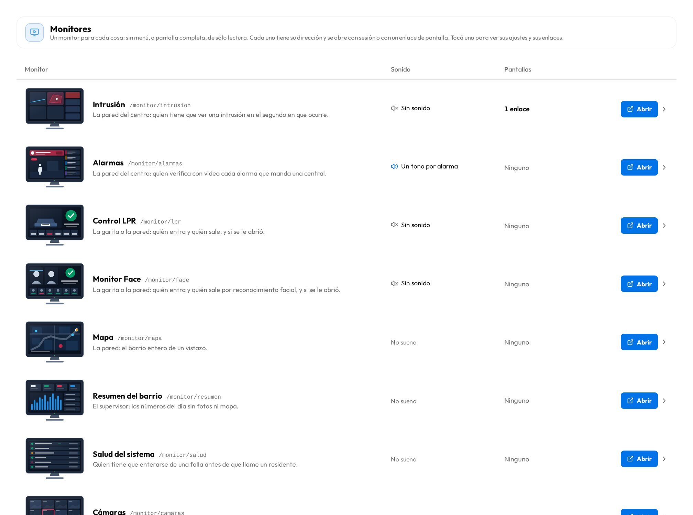

## Las vistas

| Vista | Dirección | Para qué |
|---|---|---|
| Intrusión | /monitor/intrusion | Mosaico de cámaras de intrusión; la cámara en alarma crece a media pantalla |
| Alarmas | /monitor/alarmas | Las alarmas de las centrales para verificar con video, la más urgente al frente |
| Control LPR | /monitor/lpr | Última lectura grande, quién está adentro y la fila de atención |
| Monitor Face | /monitor/face | Accesos por reconocimiento facial |
| Mapa | /monitor/mapa | El barrio entero de un vistazo |
| Resumen del barrio | /monitor/resumen | Los números del día para el supervisor |
| Salud del sistema | /monitor/salud | Cámaras, grabadores y servicios en verde, ámbar o rojo |
| Cámaras | /monitor/camaras | Canales de grabador en mosaico |
| Rotación | /monitor/rotacion | Alterna las vistas elegidas; una alarma sin resolver la detiene |

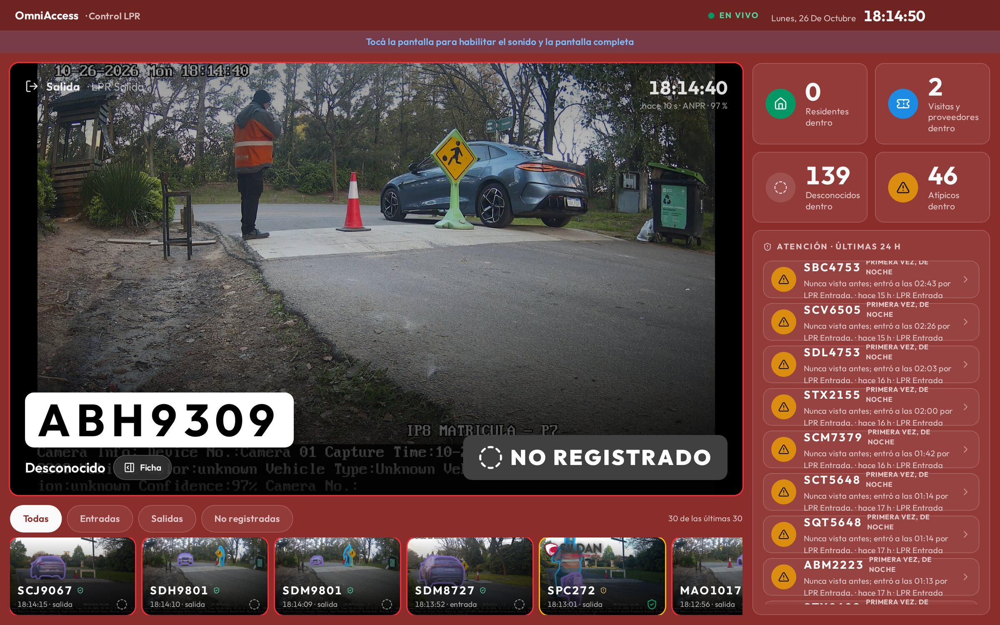

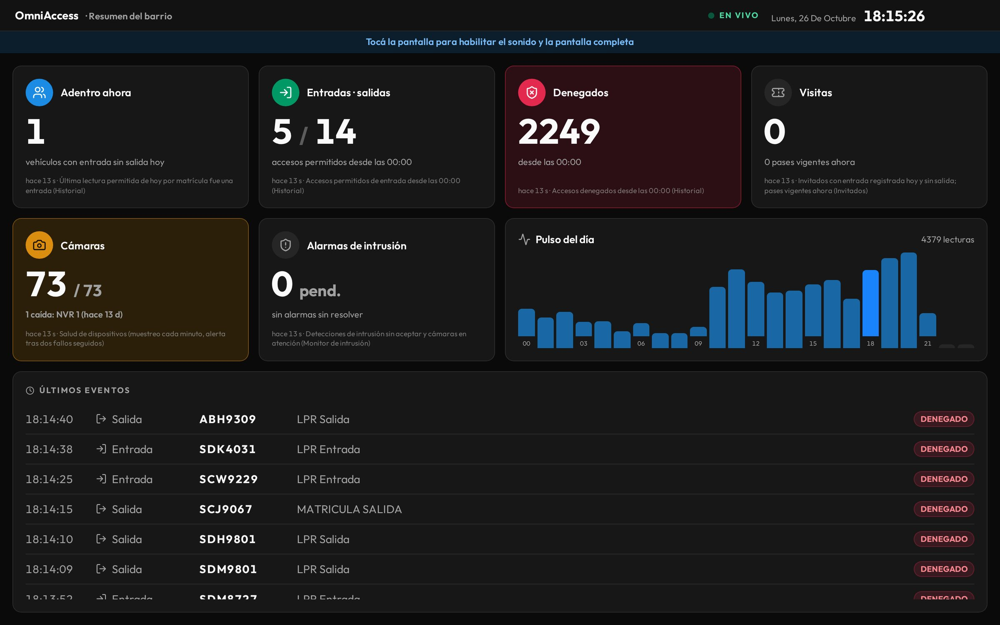

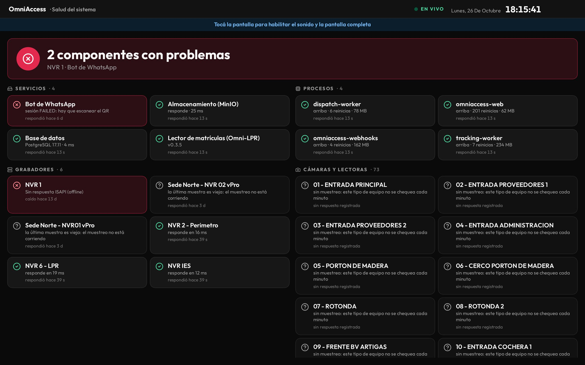

## Enlaces de pantalla

Cada vista se abre con una sesión o con un **enlace de pantalla**: un enlace con token que abre sólo esa vista, sin usuario. Así el monitor de la pared no queda con una sesión del panel abierta.

- Desde la fila de cada vista: **Abrir**, el **sonido** (sin sonido, un tono o repetir) y los **enlaces** creados.
- El encabezado de cada vista indica si está *En vivo*, *Reconectando* o *Sin datos hace N minutos*.
- Al tocar la pantalla por primera vez se habilitan el sonido y la pantalla completa.

> Crear y revocar enlaces de pantalla pide el permiso «Configurar monitores».

# Usuarios y residentes

» Menú → Usuarios y Residentes

El padrón de personas, separado en pestañas.

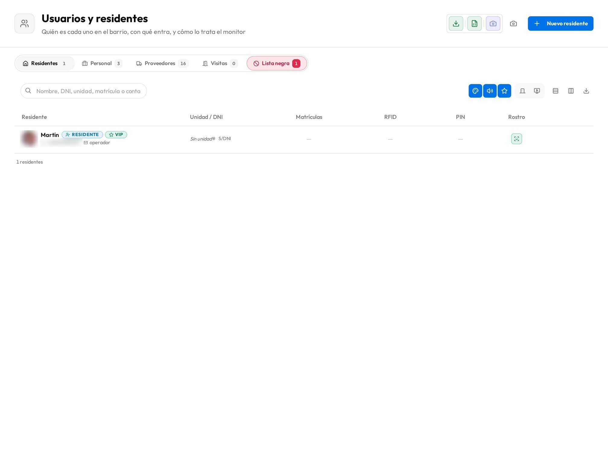

## Pestañas

- **Residentes**, **Personal**, **Proveedores** y **Visitas**, cada una con su cantidad.
- **Lista negra**, siempre a la vista con fondo rojo.

El alta de cada pestaña abre la ficha de la persona con su rol ya puesto. La ficha guarda los datos, la unidad, las matrículas, las tarjetas RFID, el PIN y el rostro.

## Lista negra

Cada entrada de la lista negra es una ficha de una persona o un vehículo, con nombre opcional, foto, una o varias matrículas, nivel, motivo, capturas y la última vez que se la vio.

| Nivel | Qué pasa |
|---|---|
| **Alerta máxima** | Se deniega siempre, se carga en las lectoras y genera alarma |
| **En búsqueda** | Pasa, pero se avisa a la guardia con el motivo |

- **Dar de baja** desactiva sus matrículas sin borrar la historia; se puede reactivar.
- Desde el Monitor LPR, «Registrar → A la lista negra» abre la misma ficha.

## VIP

El interruptor **VIP** en la ficha de residentes y personal los marca con un color propio en los monitores y, si se elige, con un sonido al pasar.

# Unidades y lotes

» Menú → Unidades / Lotes

El catastro de la instalación: lotes, casas, pisos o locales, con su complejo, su estado y sus residentes.

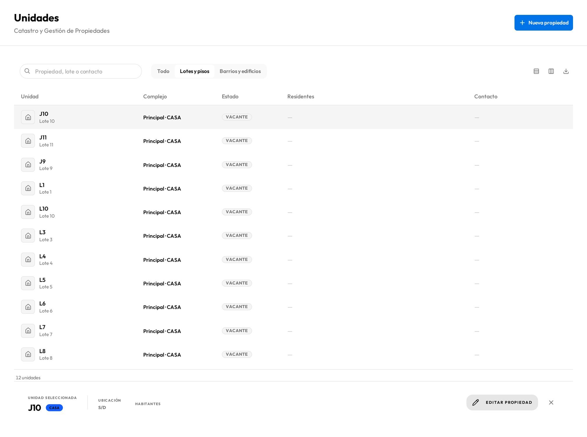

- Filtrá por lotes y pisos o por barrios y edificios.
- Tocá una unidad para ver su ficha abajo: ubicación, habitantes y contacto.
- **Nueva propiedad** da de alta una unidad.

# Vehículos

» Menú → Vehículos / Matrículas

El padrón de vehículos: cada matrícula, su vehículo y a quién pertenece.

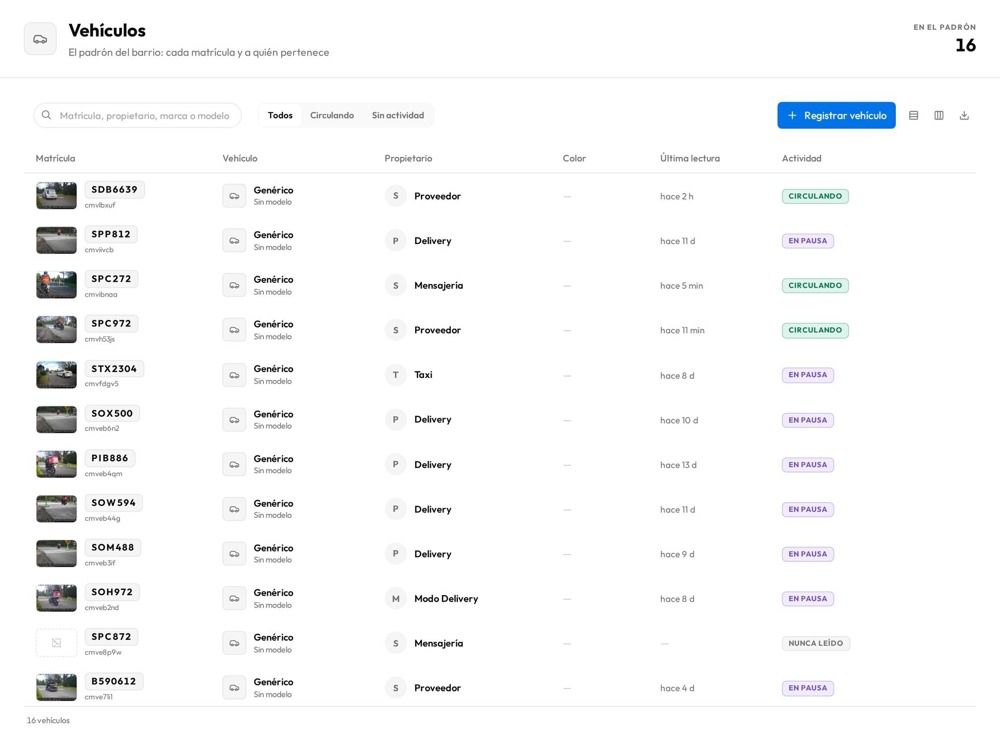

- **Actividad**: *Circulando* (pasó hace poco), *En pausa* o *Nunca leído*, y la última lectura.
- Filtrá por estado y buscá por matrícula, propietario o marca.
- **Registrar vehículo** lo da de alta y lo carga en las lectoras.

> Las matrículas se validan en formato Mercosur, moto uruguaya y uruguaya anterior. Lo que lee la cámara nunca se rechaza: si no tiene formato válido, se marca.

# Visitas

» Menú → Visitas (módulo Guardia)

Las visitas de las últimas 24 horas: quién entró, a qué lote, cuánto se quedó, cómo se cerró la visita y los avisos que tuvo la guardia.

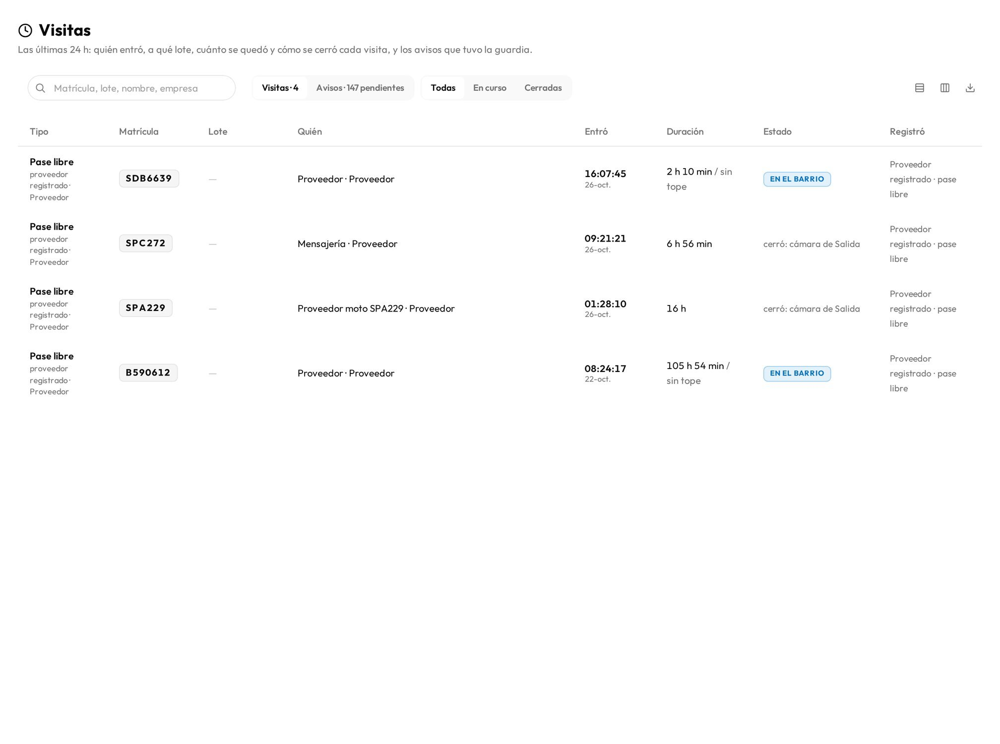

## Cómo funciona una visita

- La guardia la registra desde la consola: tipo, lote y, si se quiere, matrícula, nombre y empresa.
- Una invitación vigente abre su visita sola cuando el vehículo entra.
- Se cierra sola cuando la cámara de salida lee la matrícula; si no, la guardia toca «Salió».
- Cada tipo tiene su tiempo: Delivery 15 minutos, Servicio 2 horas, Obra 8 horas, Visita 3 horas. Se puede extender.

## Avisos a la guardia

| Aviso | Cuándo salta |
|---|---|
| Visita excedida | La visita pasó su tiempo sin salir |
| Fuera de rutina | La primera entrada del día de un habitual, en un día o una hora fuera de su rutina |
| Se quedó más de lo habitual | Una visita supera lo que suele quedarse esa matrícula |
| Primera vez, de noche | Una matrícula nunca vista entra de noche |
| Da vueltas | Pasadas repetidas sin registro en poco tiempo |

Los avisos salen en la consola de la guardia y en la fila de atención del monitor.

# Invitados

» Menú → Invitados

Los pases de visita con código QR. El residente invita desde el sistema o por el bot de WhatsApp o Telegram, y la garita escanea el pase al llegar.

- Arriba se ven los pases **activos** y cuántos están **adentro**.
- **Nuevo pase** crea una invitación desde el panel.
- **Escanear QR** valida un pase desde la cámara del dispositivo.
- **Link residente** genera el enlace para que el residente invite.

> Sólo los residentes con su teléfono cargado en la ficha pueden invitar por WhatsApp o Telegram.

# Calendario

» Menú → Calendario

Los accesos del mes en un calendario. Cada día muestra la cantidad de eventos y franjas de color por tipo; al costado, los accesos del día elegido con permitidos, denegados y avistamientos.

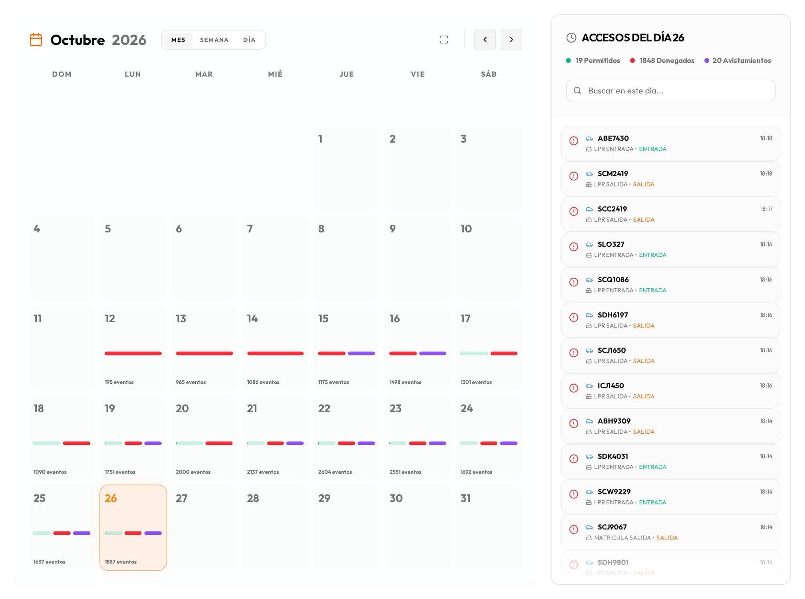

# Dispositivos

» Menú → Dispositivos

Las cámaras, grabadores, terminales y centrales de alarma de la instalación.

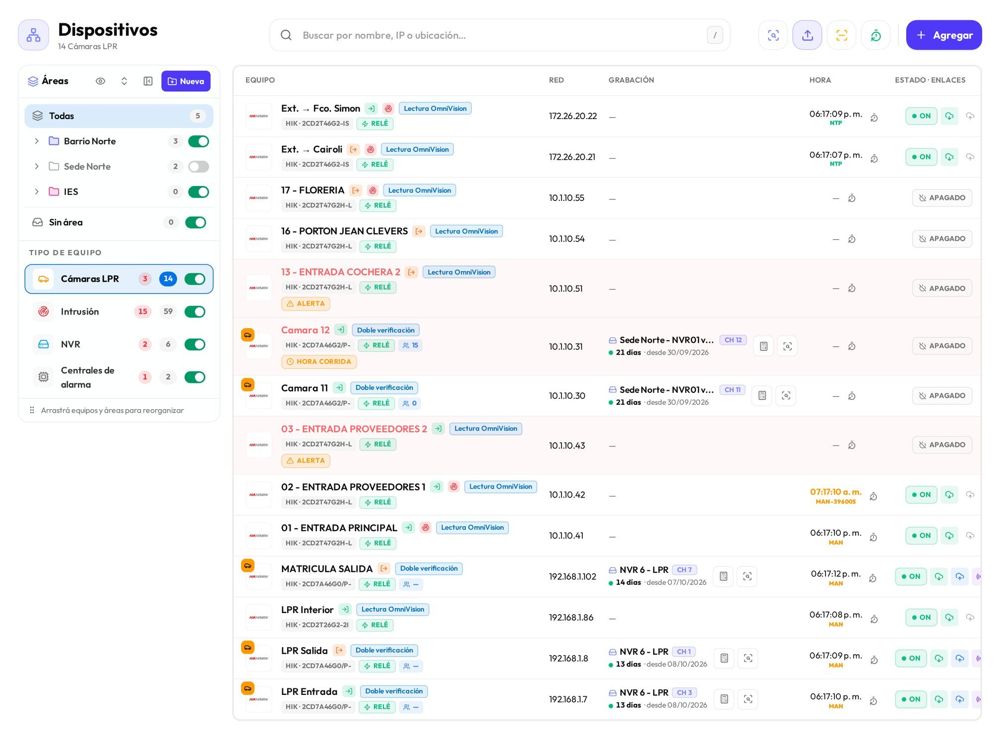

## Qué se ve

- **Áreas** a la izquierda, para agrupar equipos (arrastrables), y los **tipos de equipo**: cámaras LPR, intrusión, grabadores y centrales de alarma, con su cantidad.
- Por cada equipo: nombre, modelo, rol (por ejemplo *Doble verificación* o *Lectura OmniVision*), relé, dirección de red, grabador y canal asociado, hora del equipo y estado.

## El rol de una cámara

| Rol | Qué hace |
|---|---|
| LPR de acceso | Lee matrículas y avisa cada lectura |
| Seguimiento interior | Cámara común para seguir vehículos por el barrio |
| Intrusión | Avisa cruces de línea y zonas |
| Sólo video para OmniVision | No avisa: OmniVision analiza su video |

## Alta e importación

- **Agregar** da de alta un equipo paso a paso. El formulario dice antes de guardar qué puede hacer OmniAccess con esa marca.
- Desde un grabador se pueden **importar sus canales**, eligiendo el rol de cada uno.
- Al crear, el sistema ajusta la hora del equipo, configura que avise a OmniAccess y decide si entra en OmniVision.

## Compatibilidad por marca

| Marca | Qué hace OmniAccess |
|---|---|
| Hikvision | Matrículas, rostros, registro de accesos, relé y video |
| Akuvox | Rostros, tarjetas RFID, registro de accesos y relé |
| Bosch | Conteo de personas y video |
| Cualquier cámara con RTSP | Video para OmniVision |

# Despachos

» Menú → Despachos

La cola de lo que el sistema manda afuera: clips y alertas por Telegram o WhatsApp.

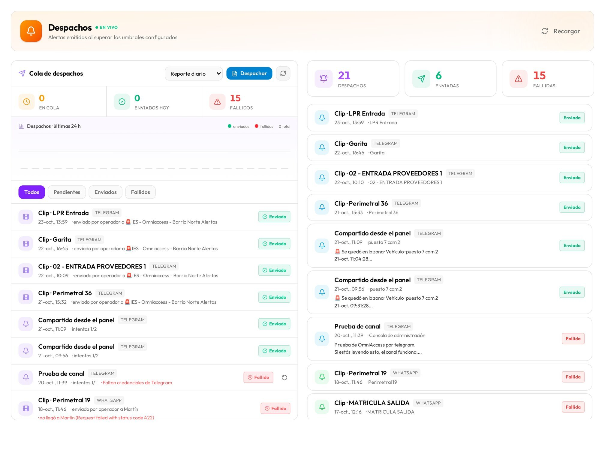

- Contadores de **en cola, enviados hoy y fallidos**.
- La lista de despachos con su canal, el origen (por ejemplo «Clip · LPR Entrada» o «Compartido desde el panel») y el estado.
- Un despacho fallido muestra el motivo y se puede reintentar.

# Configuración

» Menú → Configuración

La configuración se ordena en una barra superior: Sistema, Notificaciones, Modos, Avanzado, OmniVision y Manuales.

## Sistema

**Topología de red** dibuja cómo se conectan las cámaras, el servidor, la base de datos, el almacenamiento y los servicios, con su estado.

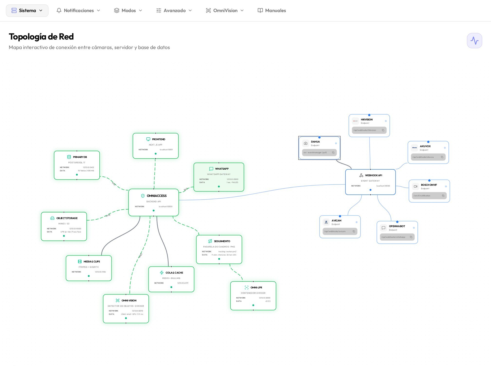

## Notificaciones

Qué sale, por dónde, a quién y cuándo.

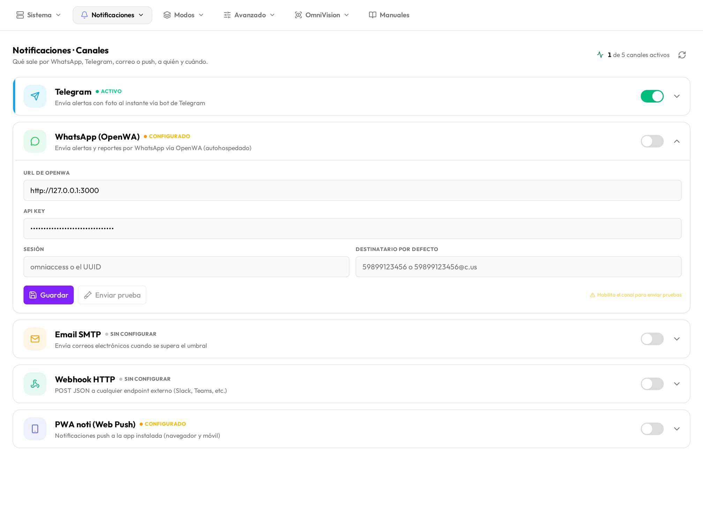

- **Canales**: Telegram, WhatsApp (OpenWA), correo SMTP, Webhook HTTP y notificación push en el navegador o el celular. Cada canal se prende, se configura y se prueba.
- **Reglas**: por módulo (LPR, intrusión, filas, OmniVision, centrales), qué evento dispara el aviso, por qué canal y en qué horario.

## Modos

- Los productos activos en la instalación.
- **Matrículas**: funciones de OmniAccess LPR, como Plazas de parking.
- **Visitas y patrones**: barrio abierto o cerrado, tipos de visita y avisos a la guardia.
- **Centrales de alarma**: prioridades, cierres, procedimiento y escalado.

## Accesos (roles y permisos)

Los permisos se dan por módulo y en tres niveles: **Ver**, **Operar** y **Configurar**.

- Hay plantillas listas: Supervisor, Operador de monitoreo, Guardia de garita, Técnico, Administración y Auditor.
- Los permisos delicados (Accesos, Mantenimiento, armar y desarmar centrales, enlaces de pantalla) están marcados.
- Siempre queda al menos una persona con permiso de Accesos.
- El servidor controla cada acción, no sólo el menú.

## Almacenamiento

Cuánto tiempo se guarda cada tipo de imagen (lecturas, intrusión, rostros, detecciones), por regla de retención.

## Manuales

Los manuales del sistema, para leer en el navegador o descargar en PDF. Este manual está ahí.

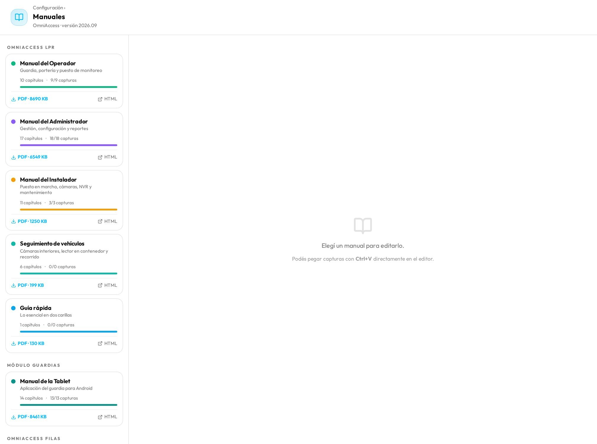

# Auditoría

» Configuración → Auditoría

El registro de quién hizo qué: entradas al panel, cambios de configuración, altas y bajas, y el tratamiento de cada alarma. La auditoría de equipos muestra cada dispositivo con su tipo, dirección, estado y última sincronización.

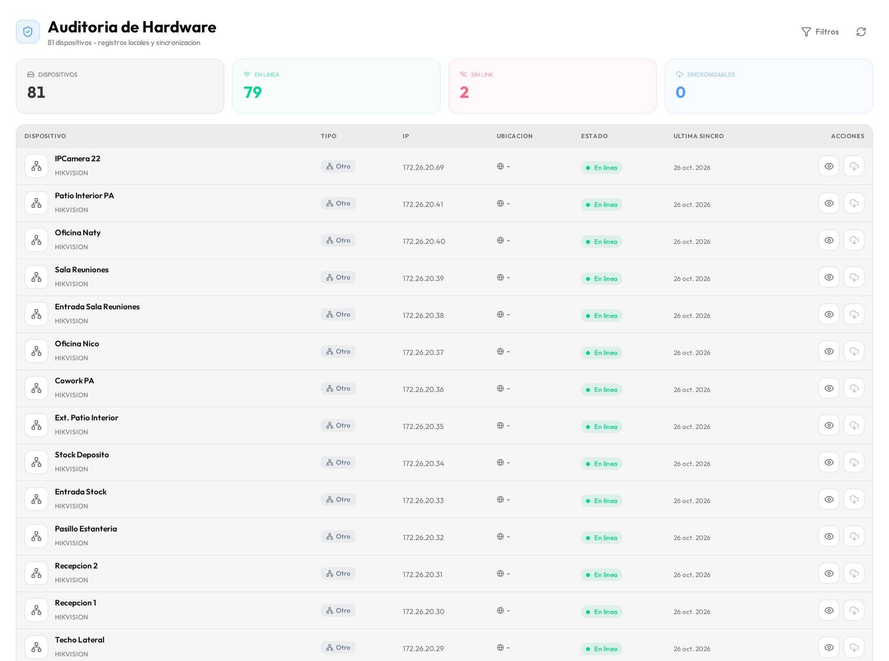

# Consola de guardia

» Dirección de la instalación → /guard

La aplicación de la garita y de la tablet del guardia. Se ingresa con usuario y contraseña de guardia, no con una cuenta del panel.

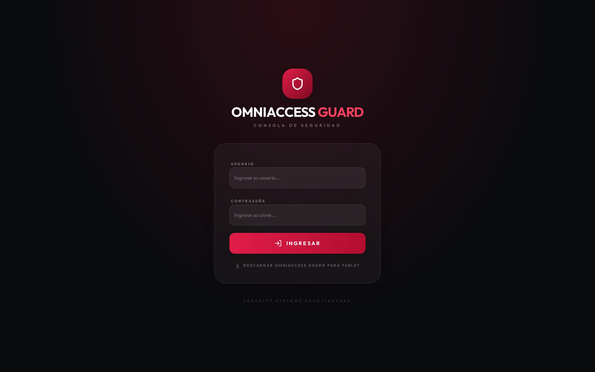

Desde la consola el guardia:

- registra ingresos y egresos manuales, con matrícula y lote de destino;
- registra y cierra visitas, y ve los avisos pendientes;
- anota novedades y rondas en la bitácora;
- consulta el historial y el mapa;
- usa el botón de pánico.

## Bitácora y consolas en el panel

» Menú → Bitácora · Menú → Consolas

- **Bitácora**: lo que anotó la guardia (novedades, rondas y visitas), con filtros por tipo y fecha.
- **Consolas**: los puestos de guardia, el historial de registros manuales y el acceso al botón de pánico.

> El manual de la tablet detalla la aplicación del guardia para Android.

# OmniAccess Face

OmniAccess Face controla el acceso de personas con terminales de reconocimiento facial, tarjetas RFID y porteros.

## Monitor facial

» Menú → Monitor Facial

Los accesos por rostro en vivo, separados en entradas y salidas, con las capturas recientes en el centro. Se filtra por todos, permitidos o denegados.

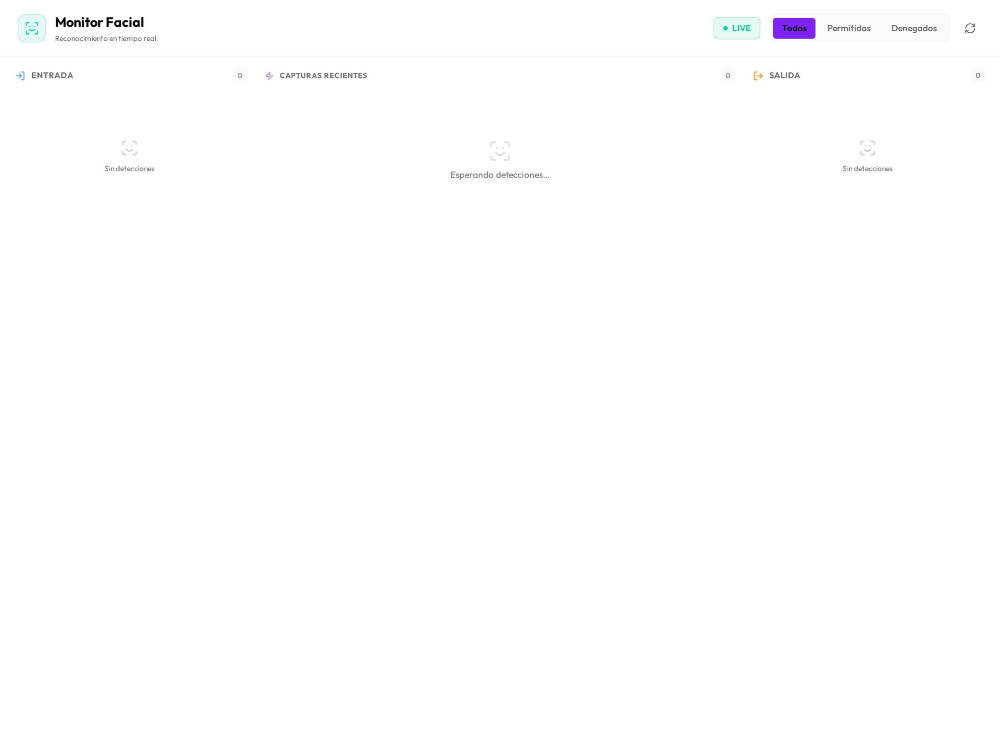

La vista de pared **Monitor Face** muestra la foto tomada y la del padrón lado a lado, el parecido, la persona y su unidad, el motivo (permitido, desconocido, lista negra o denegado), los diez accesos anteriores y los contadores del día.

## Rostros y terminales

- El rostro se carga desde la ficha de la persona, con una foto, o importando el padrón.
- El sistema lo sincroniza con cada terminal del grupo de acceso de la persona.
- Terminales compatibles: Hikvision y Akuvox.

## Grupos de acceso y horarios

» Menú → Grupos de Acceso

Un grupo define quién puede abrir qué equipos y en qué horario. Cada persona pertenece a uno o más grupos.

## Tags RFID

» Menú → Tags RFID

Las tarjetas y llaveros de la instalación, a quién están asignados y en qué estado. Una tarjeta se asigna a una persona y se carga en las terminales Akuvox.

# OmniAccess Filas

OmniAccess Filas cuenta personas en filas, salas de espera y accesos, avisa cuando se supera el límite y muestra el estado en una pantalla para el público.

## Control de filas

» Menú → Control de Filas

La detección por fila en vivo: el aforo de cada cámara de conteo, las entradas y salidas, y el umbral de cada fila. **Nuevo umbral** define el límite y el aviso.

## Bandas y avisos

- El estado de cada fila se lee en tres bandas: con lugar (menos del 70 % del límite), cerca del límite (70 % a 100 %) y llena.
- Al pasar el límite se avisa a la guardia con foto; si no baja en el tiempo configurado, se avisa al supervisor.
- Fuera del horario de atención no se avisa; al abrir, las entradas y salidas vuelven a cero.

## Pantalla de sala

» Menú → Kiosko

Una pantalla para la sala de espera que dice **Pase** o **Espere**, con las personas en fila y los minutos de espera estimados.

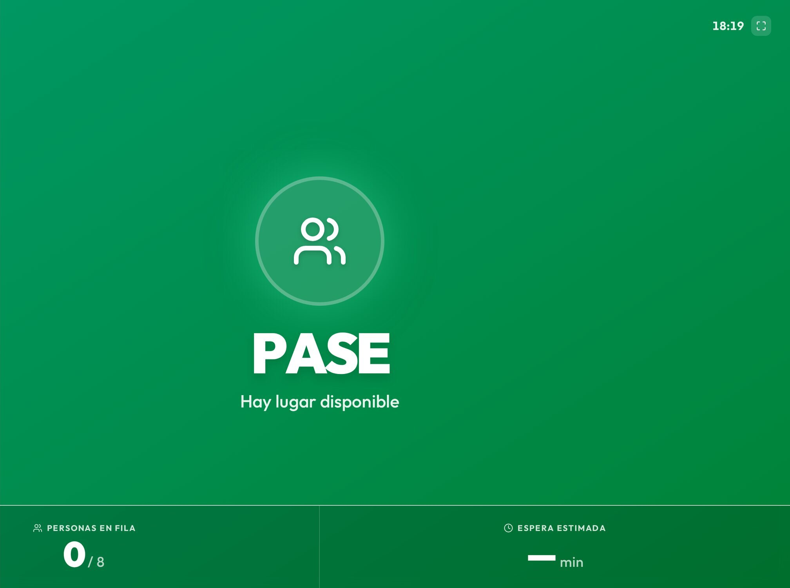

## Flujo y reportes

- **Flujo de filas**: el aforo, las entradas y salidas en el tiempo, y la tabla de eventos de cada cámara.
- **Reportes de afluencia**: por hora, día, semana o mes, con lecturas, aforo promedio y pico máximo. Exporta a Excel y PDF.

## Horarios y calibración

» Menú → Horarios de filas · Menú → Calibración de aforo

El horario de atención de cada fila en un calendario, con días especiales. La calibración de aforo ajusta el conteo de cada cámara.

## Cámaras de conteo

El conteo se hace con la analítica de cámaras Bosch, leída por ONVIF, o con OmniVision sobre cualquier cámara (ver el capítulo OmniVision → Filas).

# Servidor y placa de video

OmniAccess corre en un servidor dentro de la instalación. La placa de video (GPU) hace el trabajo de la inteligencia artificial, y se elige según las analíticas que se van a usar.

## Cuántas cámaras entran por analítica

La tabla da cuántas cámaras soporta cada analítica prendida sola, usando la mitad de la placa. La otra mitad queda para las ráfagas del lector de chapas.

| Analítica | RTX 3050 · 6 GB | RTX 2000 Ada · 16 GB |
|---|---|---|
| Doble verificación de matrículas e intrusión (~30 ms por evento) | 100 o más | 100 o más |
| Registro OmniVision: detecciones y búsqueda (21 a 28 ms por cuadro) | 30 | 60 |
| Matrículas por video en cámara común (~0,54 s por vehículo) | 7 | 9 a 10 (estimado) |
| Reglas en vivo: merodeo, permanencia, fila (4 cuadros por segundo) | 3 a 4 | 3 a 6 |
| Pose: persona en el suelo, trepando (1 cuadro por segundo) | 4 a 5 | 8 |
| Búsqueda por texto (2 GB de memoria de video) | sólo de noche | continua |

> Mediciones propias de octubre de 2026. Para instalaciones de más de 60 cámaras con analítica, el escenario de referencia es una RTX PRO 4000 de 24 GB o una segunda placa; se dimensiona en el relevamiento.

## Qué consume cada analítica

| Analítica | Cada cuánto | Tiempo de GPU |
|---|---|---|
| Registro OmniVision | cada 2 s, si cambió la escena | 21 a 28 ms |
| Reglas en vivo | 4 cuadros por segundo, siempre | 21 a 28 ms |
| Pose | se suma a la regla, por cuadro | 37 a 78 ms |
| Doble verificación | una vez por evento de la cámara | ~30 ms |
| Relectura de matrículas dudosas | una vez por lectura dudosa | ~100 ms |
| Texto y rotulado | una vez por vehículo | 118 a 200 ms |
| Matrículas por video | ráfaga por vehículo | ~0,54 s |

Lo que más pesa es lo que corre todo el tiempo por cámara: las reglas en vivo y la pose. La doble verificación casi no consume.

## Cómo dejar cada cámara

| Rol | Stream principal | Substream |
|---|---|---|
| LPR con lectura propia | lo que pida la cámara | 704×576, 10 c/s |
| Matrículas por video | 4 MP, H.264, 15 c/s | 704×576, 10 c/s |
| Intrusión con doble verificación | 4 MP, 15 c/s | 704×576, H.264, 10 c/s |
| Registro, búsqueda y reglas | 4 MP | 704×576, H.264, 8 a 12 c/s |

> Para que una cámara común lea matrículas, la chapa tiene que medir 130 píxeles o más: no más de 8 metros de ancho de escena a la altura de la chapa, y ángulos menores a 30°.

# Glosario

| Término | Significado |
|---|---|
| ANPR | Lectura automática de matrículas que hace la propia cámara |
| Doble verificación | La segunda lectura o la confirmación que hace OmniVision sobre un evento de la cámara |
| OmniVision | La inteligencia artificial propia de OmniAccess |
| Silueta | El contorno exacto de un objeto detectado |
| Regla | Una línea o zona sobre una cámara con una condición que dispara un aviso |
| Merodeo | Una persona que da vueltas dentro de una zona |
| Estadía | El tiempo que un vehículo estuvo estacionado o dentro del barrio |
| Enlace de pantalla | Un enlace con token que abre una vista de pared sin usuario |
| Central de alarma | El panel de alarma de un abonado, que reporta por SIA DC-09 o Contact ID |
| Grabador (NVR) | El equipo que graba el video de las cámaras |
| GPU | La placa de video del servidor, que procesa la inteligencia artificial |
